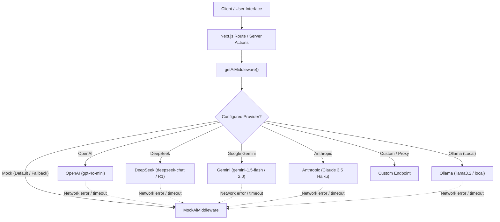

# 46Hz AI Intelligence & Empathetic Assistance System

## 1. Overview & Philosophy

46Hz is an anonymous, slow-paced emotional support letterbox grounded in the Schumann Resonance (46Hz harmonic of the Earth's natural resonance). Rather than replacing human compassion with automated chatbots, the AI system in 46Hz is designed as a **gentle empathetic scaffolding (온화한 공감의 비계)**:
- **Never diagnoses or replaces professional therapy**: Preserves human peer connection without clinical labeling.
- **Privacy First (Data Minimization)**: Zero user IP, session tokens, or account identifiers are ever sent to LLM providers. Only sanitized letter and reply texts are evaluated.
- **Offline Zero-Breakage Guarantee**: If any external LLM provider experiences latency, downtime, or lacks API credentials, the system automatically falls back to the deterministic, high-fidelity `MockAiMiddleware` with zero service interruption.

---

## 2. Multi-Provider LLM Engine Architecture

The pluggable LLM system is centered on the `AiMiddleware` interface:

### Supported Providers & Default Configurations

| Provider | Default Base URL | Default Model | Authentication Header | JSON Mode Support |
| :--- | :--- | :--- | :--- | :--- |
| `openai` | `https://api.openai.com/v1` | `gpt-4o-mini` | `Authorization: Bearer <KEY>` | `response_format: json_object` |
| `deepseek` | `https://api.deepseek.com/v1` | `deepseek-chat` | `Authorization: Bearer <KEY>` | `response_format: json_object` |
| `gemini` | `https://generativelanguage.googleapis.com/v1beta/openai` | `gemini-1.5-flash` | `Authorization: Bearer <KEY>` | `response_format: json_object` |
| `anthropic` | `https://api.anthropic.com/v1` | `claude-3-5-haiku-20241022` | `x-api-key: <KEY>`, `anthropic-version: 2023-06-01` | Prompt structured JSON |
| `ollama` | `http://localhost:11434/v1` | `llama3.2` | Optional / none | Flexible JSON extraction |
| `custom` | Custom `AI_BASE_URL` | Custom `AI_MODEL` | `Authorization: Bearer <KEY>` | OpenAI compatible |
| `mock` | Local memory | Deterministic rule-based engine | None (offline) | Direct typed objects |

---

## 3. Core AI Modules & Features

### 3.1. Writing Sparks Assistant (`WritingSparksHelper`)
- **Location**: `components/writing-sparks-helper.tsx`, `/api/ai/writing-sparks`
- **Purpose**: Helps writers overcome the initial barrier of expression when feeling overwhelmed, anxious, lonely, or ashamed.
- **Functionality**:
  - Mood selector pills ("지침/번아웃", "불안/걱정", "외로움/고립", "자책/부끄러움").
  - Dynamically crafts 3 tailored opening sentences with thematic tags.
  - One-click insertion into the stationery editor.
  - Full KWCAG 2.2 accessibility with ARIA live regions and 44px touch targets.

### 3.2. Multi-turn Reply Coach Workbench (`CoachedReplyWorkbench`)
- **Location**: `components/reply-composer.tsx`, `app/actions/replies.ts`
- **Purpose**: Encourages compassionate, non-judgmental communication between peer respondents.
- **Key Sub-systems**:
  1. **Tone Radar**: Real-time evaluation of:
     - **Empathy Score (공감 지수)**: Detects emotional resonance and validation.
     - **Gentleness Score (온화함)**: Detects softened phrasing and pacing.
     - **Non-Judgmental Score (비판단성)**: Flags unsolicited directives ("you should", "stop feeling sorry").
  2. **Perspective Reframings (3 Healing Tones)**:
     - **Gentle Empathy (온화한 공감)**: Warm, heart-centered acknowledgement of the writer's burdens.
     - **Deep Listening (경청 중심)**: Reassurance that the respondent heard every word without rush.
     - **Calm Grounding (차분한 지지)**: Gentle reminders to breathe and take one step at a time.
  3. **One-Click Reframe Application**: Respondents can click any tone chip to immediately swap the draft reply, then edit further.

### 3.3. Semantic Resonance Matcher (`matchResonantLetters`)
- **Location**: `lib/ai/middleware.ts`, `/api/ai/resonance-match`, `app/reply/page.tsx`
- **Purpose**: Pairs letters seeking care with respondents whose chosen care style (Comfort, Listening, Similar Experiences, Gentle Advice) best harmonizes with the writer's emotional needs.
- **Visual Presentation**:
  - Highlights resonant letters with a glowing `공명 추천 (Resonance Match)` badge.
  - Displays a concise empathetic rationale explaining why the letter resonates.
  - Orders recommended letters to the top of the pool.

### 3.4. Enhanced PII Anonymizer & Safety Classifier
- **Location**: `lib/ai/mock.ts`, `lib/ai/llm.ts`, `/api/ai/anonymize`
- **Detection Capabilities**:
  - Korean Resident Registration Numbers (`\d{6}-[1-4]\d{6}` -> `[식별번호 비공개]`)
  - Korean & International Phone Numbers (`010-XXXX-XXXX`, etc. -> `[연락처 비공개]`)
  - Bank Account Numbers (`[계좌번호 비공개]`)
  - KakaoTalk, LINE, and Telegram IDs (`[메신저 아이디 비공개]`)
  - Full Names & Explicit addresses (`[name removed]`)
  - 4-Tier Risk Classification: `NORMAL`, `SENSITIVE`, `HIGH`, `BLOCKED`.

### 3.5. Admin Emotion Climate Radar
- **Location**: `app/admin/page.tsx`
- **Purpose**: Provides operational staff and moderators with a live collective overview of the community's emotional climate without reading individual private letters.
- **Aggregated Metrics**:
  - Proportional breakdown of Loneliness, Anxiety, Burnout, and Sadness.
  - Visualized as responsive progress meters with sampling volume counters.

---

## 4. Verification & Integrity Checklist

- [x] **Vitest Unit Tests**: 19 test files, 125 tests passing (including LLM providers, Mock, PII anonymizer, Writing Sparks, Resonance Matcher, and KWCAG accessibility).
- [x] **Backend Integration Verification**: `scripts/verify_backend.ts` verified with zero regressions.
- [x] **TypeScript & Linter**: `tsc --noEmit` clean with zero errors.
- [x] **Turbopack Production Build**: `next build` static page generation and dynamic routing compiled cleanly.
