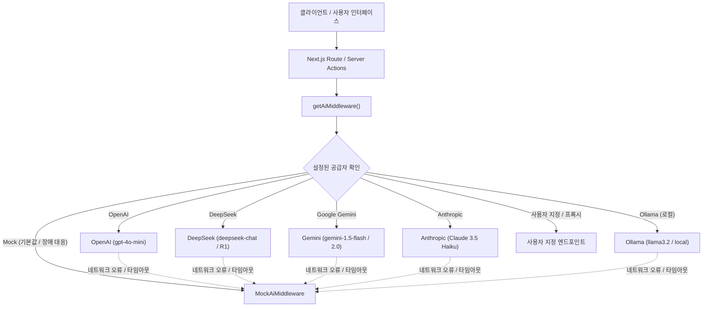

# 46Hz AI 인텔리전스 및 공감형 보조 시스템 매뉴얼
**46Hz AI Intelligence & Empathetic Assistance System Manual**

## 1. 개요 및 설계 철학 (Overview & Philosophy)

46Hz는 지구 자연 공명 주파수의 7차 고조파인 46Hz(슈만 공명)에 착안하여 기획된, 느린 호흡의 익명 정서 지원 편지함 플랫폼입니다. 본 시스템은 인간 본연의 따뜻한 공감을 자동화된 챗봇으로 대체하지 않으며, AI를 **'온화한 공감의 비계(Gentle Empathetic Scaffolding)'**로 정의하여 다음과 같은 원칙에 따라 동작합니다:

- **전문 심리 치료를 진단하거나 대체하지 않음**: 임상적 낙인이나 진단을 배제하고, 동료 간의 순수한 정서적 유대와 공감을 보존합니다.
- **프라이버시 최우선 (데이터 최소화 원칙)**: 사용자의 IP, 세션 토큰, 계정 식별자 등 어떠한 개인 식별 정보(PII)도 외부 LLM 제공업체에 전송하지 않습니다. 오직 비식별 정돈된 편지 및 답장 텍스트만을 평가 대상으로 삼습니다.
- **오프라인 무중단 가용성 보장 (Zero-Breakage Guarantee)**: 외부 LLM 공급자의 네트워크 지연, 서버 장애 또는 API 키 부재 상황 발생 시, 내장된 고신뢰도 결정론적 규칙 엔진인 `MockAiMiddleware`로 즉시 자동 폴백하여 서비스 중단을 원천 방지합니다.

---

## 2. 다중 제공자 LLM 엔진 아키텍처 (Multi-Provider LLM Engine Architecture)

플러그형(Pluggable) LLM 시스템은 `AiMiddleware` 인터페이스를 핵심 추상화 계층으로 채택하고 있습니다:

### 지원 공급자 및 기본 구성 사양

| 제공자 (`Provider`) | 기본 Base URL | 기본 모델 (`Model`) | 인증 헤더 | JSON 모드 지원 |
| :--- | :--- | :--- | :--- | :--- |
| `openai` | `https://api.openai.com/v1` | `gpt-4o-mini` | `Authorization: Bearer <KEY>` | `response_format: json_object` |
| `deepseek` | `https://api.deepseek.com/v1` | `deepseek-chat` | `Authorization: Bearer <KEY>` | `response_format: json_object` |
| `gemini` | `https://generativelanguage.googleapis.com/v1beta/openai` | `gemini-1.5-flash` | `Authorization: Bearer <KEY>` | `response_format: json_object` |
| `anthropic` | `https://api.anthropic.com/v1` | `claude-3-5-haiku-20241022` | `x-api-key: <KEY>`, `anthropic-version: 2023-06-01` | 프롬프트 기반 구조화 JSON |
| `ollama` | `http://localhost:11434/v1` | `llama3.2` | 선택 사항 / 없음 | 유연한 JSON 추출 파이프라인 |
| `custom` | 사용자 지정 `AI_BASE_URL` | 사용자 지정 `AI_MODEL` | `Authorization: Bearer <KEY>` | OpenAI 호환 프로토콜 |
| `mock` | 로컬 인메모리 | 결정론적 규칙 기반 엔진 | 불필요 (완전 오프라인) | 직접 타이핑된 객체 반환 |

---

## 3. 핵심 AI 모듈 및 기능 명세 (Core AI Modules & Features)

### 3.1. 글감 영감 어시스턴트 (`WritingSparksHelper`)
- **코드 위치**: `components/writing-sparks-helper.tsx`, `/api/ai/writing-sparks`
- **목적**: 감정적으로 지치거나 불안, 고립감, 자책감에 휩싸여 첫 문장을 시작하기 어려운 작성자의 심리적 진입 장벽을 해소합니다.
- **주요 기능**:
  - 감정 선택 칩 제공 ("지침/번아웃", "불안/걱정", "외로움/고립", "자책/부끄러움").
  - 감정에 맞춘 3가지 맞춤형 시작 문장과 테마 태그를 동적으로 생성.
  - 클릭 한 번으로 편지지 에디터 본문에 자연스럽게 삽입.
  - ARIA 라이브 리전 및 최소 44px 터치 영역을 준수하는 KWCAG 2.2 웹 접근성 완벽 충족.

### 3.2. 다회차 답장 코치 워크벤치 (`CoachedReplyWorkbench`)
- **코드 위치**: `components/reply-composer.tsx`, `app/actions/replies.ts`
- **목적**: 답장을 작성하는 동료가 비판단적이고 따뜻한 어조로 소통할 수 있도록 실시간으로 안내합니다.
- **핵심 서브시스템**:
  1. **톤 레이더 (Tone Radar)**: 다음 3가지 지표를 실시간 측정:
     - **공감 지수 (Empathy Score)**: 정서적 공명과 수용적 태도 감지.
     - **온화함 지수 (Gentleness Score)**: 부드러운 완충 표현과 차분한 호흡 감지.
     - **비판단성 지수 (Non-Judgmental Score)**: 일방적인 훈계나 단정적 지시("~해야 합니다", "자책 그만하세요" 등) 감지 및 경고.
  2. **관점 리프레이밍 (3대 치유 톤)**:
     - **온화한 공감 (Gentle Empathy)**: 작성자의 무거운 마음에 따뜻한 온기와 지지를 전하는 문장.
     - **경청 중심 (Deep Listening)**: 조급한 해결책 대신 한 문장 한 문장을 깊이 귀담아들었음을 전하는 문장.
     - **차분한 지지 (Calm Grounding)**: 깊은 호흡과 함께 한 걸음씩 나아가도록 돕는 차분한 문장.
  3. **원클릭 리프레임 적용**: 톤 칩을 클릭하여 추천된 문장으로 즉시 초안을 교체한 후 추가 편집 가능.

### 3.3. 시맨틱 공명 매칭기 (`matchResonantLetters`)
- **코드 위치**: `lib/ai/middleware.ts`, `/api/ai/resonance-match`, `app/reply/page.tsx`
- **목적**: 돌봄을 바라는 편지와, 동료가 선택한 위로 방식(위로와 온기, 조용한 경청, 유사한 경험 나누기, 부드러운 조언)이 가장 조화롭게 어우러지도록 연결합니다.
- **시각적 UI 제공**:
  - 공명도가 높은 편지에 은은하게 빛나는 `공명 추천 (Resonance Match)` 배지 표시.
  - 왜 이 편지와 마음이 맞닿아 있는지 설명하는 따뜻한 추천 사유 요약 제공.
  - 추천 편지를 답장 대기 풀 최상단으로 우선 정렬.

### 3.4. 강화된 개인정보(PII) 익명화 및 안전성 분류기
- **코드 위치**: `lib/ai/mock.ts`, `lib/ai/llm.ts`, `/api/ai/anonymize`
- **감지 및 마스킹 역량**:
  - 대한민국 주민등록번호 (`\d{6}-[1-4]\d{6}` $\rightarrow$ `[식별번호 비공개]`)
  - 국내 및 국제 전화번호 (`010-XXXX-XXXX` 등 $\rightarrow$ `[연락처 비공개]`)
  - 은행 계좌번호 (`[계좌번호 비공개]`)
  - 카카오톡, 라인, 텔레그램 메신저 ID (`[메신저 아이디 비공개]`)
  - 실명 및 구체적 상세 주소 (`[성명 비공개]`, `[주소 비공개]`)
  - 4단계 콘텐츠 위험도 분류: `NORMAL`(정상), `SENSITIVE`(민감), `HIGH`(고위험/위기), `BLOCKED`(차단 대상).

### 3.5. 관리자 감정 기후 레이더 (Admin Emotion Climate Radar)
- **코드 위치**: `app/admin/page.tsx`
- **목적**: 운영진과 모더레이터가 개별 사용자의 사적인 편지 원문을 무단 열람하지 않고도, 커뮤니티 전반의 정서적 흐름과 위기 수준을 총체적으로 파악할 수 있도록 지원합니다.
- **집계 지표**:
  - 외로움(Loneliness), 불안(Anxiety), 번아웃(Burnout), 슬픔(Sadness)의 실시간 백분율 분포.
  - 표본 데이터 수량 카운터가 연동된 반응형 프로그레스 미터로 시각화.

---

## 4. 검증 및 시스템 무결성 체크리스트 (Verification & Integrity Checklist)

- [x] **Vitest 단위 테스트**: 19개 테스트 파일, 125개 테스트 전원 통과 (LLM 어댑터, Mock, PII 익명화기, Writing Sparks, 공명 매칭기, KWCAG 접근성 포함).
- [x] **백엔드 통합 검증 파이프라인**: `scripts/verify_backend.ts` 7단계 검증 회귀 오류 0건 완료.
- [x] **TypeScript 정적 타입 및 린터**: `tsc --noEmit` 에러 0건 무결성 유지.
- [x] **Turbopack 프로덕션 빌드**: `next build` 정적 페이지 생성 및 동적 서버 액션 정상 컴파일 완료.
