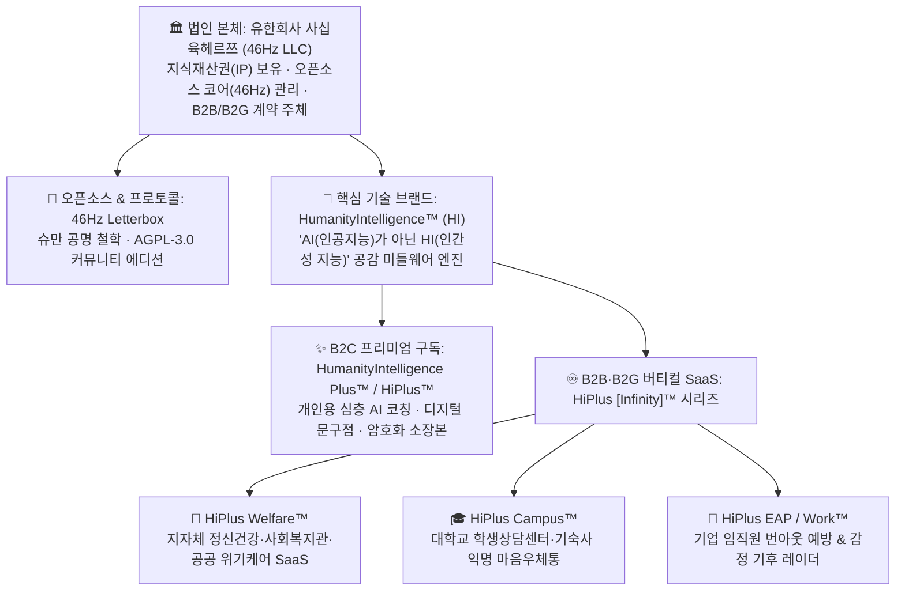

# 46Hz LLC (유한회사 사십육헤르쯔) SaaS 수익화 및 상표권(IP) 전략 매뉴얼

> **법인 주체 (Corporate Entity)**: 유한회사 사십육헤르쯔 (`46Hz LLC`)  
> **오픈소스 코어 (Open-Core Protocol)**: `46Hz` (Schumann Resonance Slow Letterbox)  
> **핵심 상표 포트폴리오 (Trademark Portfolio)**: `HumanityIntelligence™`, `HumanityIntelligence Plus™`, `HiPlus™`, `HiPlus [Infinity]™` (예: `HiPlus Welfare™`)  
> **최종 업데이트**: 2026-10-16  

---

## 1. 비전 및 지배구조 아키텍처 (Corporate & Brand Hierarchy)

정서적 지지와 익명성을 다루는 플랫폼은 **"사용자의 심리적 안전(비광고·Zero-PII 익명성)"**을 훼손하지 않으면서도 지속 가능한 **현금 흐름(SaaS MRR/ARR)**과 **지식재산권 방어막(라이선스·상표권)**을 동시에 확보해야 합니다.

이를 위해 법인 본체는 **`유한회사 사십육헤르쯔 (46Hz LLC)`**로 설립하고, 오픈소스 프로토콜(`46Hz`) 위에 독점 상용 기술 브랜드(**`HumanityIntelligence™`**)와 구독·버티컬 SaaS 브랜드(**`HiPlus™`** 시리즈)를 결합하는 이원화 구조를 채택합니다.

### 1.1 왜 `유한회사 사십육헤르쯔 (46Hz LLC)`인가?
1. **상호권 확보 및 숫자+단위 상표 허들 우회**:
   - `"46Hz"`는 숫자와 주파수 단위 조합이어서 상표 단독 출원 시 식별력 심사 허들이 존재할 수 있으나, 대한민국 상법상 법인 등기 상호(**`유한회사 사십육헤르쯔`**, 영문 **`46Hz LLC`**)로는 제약 없이 즉시 등기 및 상호권 보호가 가능합니다.
2. **프라이버시·철학 중심 경영에 최적화된 법인격**:
   - 주식회사와 달리 유한회사(LLC)는 외부 회계감사 및 재무제표 공시 부담이 적고, 이사회·감사 의무 설치 면제 및 지분 양도 제한을 통해 창업자의 철학과 경영권을 100% 방어할 수 있습니다.

### 1.2 왜 `HumanityIntelligence (HI)`인가?
- 모두가 차가운 **`AI (Artificial Intelligence, 인공지능)`**를 내세울 때, 46Hz는 **"AI는 개인정보를 가려주고 다정한 어조를 돕는 조용한 미들웨어일 뿐, 실제로 마음을 치유하는 것은 인간 대 인간의 공감 지능인 `HI (HumanityIntelligence, 인간성 지능)`이다"**라는 독보적인 브랜드 서사를 구축합니다.

---

## 2. 4대 핵심 상표 포트폴리오 및 특허청(KIPO) 출원 전략

오픈소스 라이선스(`AGPL-3.0`)는 **코드 저작권**만 조건부로 허여할 뿐, **상표권(브랜드명·로고)**은 일절 허여하지 않습니다. 따라서 제3자가 코드를 포크하더라도 아래 4대 상표를 등록해 두면 공식 브랜드 사칭이나 무단 상업 호스팅을 법적으로 즉시 차단할 수 있습니다.

### 2.1 출원 대상 4대 상표 체계
1. **`HumanityIntelligence`**
   - 코어 공감 지능 엔진 및 엔터프라이즈 플랫폼 마스터 브랜드.
2. **`HumanityIntelligence Plus`**
   - 프리미엄 구독 멤버십 및 상위 에디션 공식 명칭.
3. **`HiPlus`**
   - `HumanityIntelligence Plus`의 축약형(`HI` + `Plus`)이자, 따뜻한 인사(`"Hi+"`)의 중의적 의미를 담은 대중 친화적 브랜드.
4. **`HiPlus [Infinity]` (확장형 버티컬 상표군 — 예: `HiPlus Welfare`)**
   - 산업군·도입 기관별 모듈형 B2B/B2G SaaS 패키지 브랜드:
     - **`HiPlus Welfare`**: 사회복지관, 지자체 정신건강복지센터, 청소년상담복지센터용 공공 복지 SaaS
     - **`HiPlus Campus`**: 대학교 학생상담센터 및 기숙사 전용 익명 정서 지원 SaaS
     - **`HiPlus EAP` / `HiPlus Work`**: 기업 인사(HR) 번아웃 예방 및 감정 기후 레이더 SaaS

### 2.2 특허청(KIPO) 지정상품 분류 및 선등록 상표 충돌 회피 전략

> [!IMPORTANT]
> **국내 선등록 상표 `'하이플러스(HiPlus)'`와의 유사군 코드 분리 전략**
> 국내에는 하이패스 선불카드 기업인 SM하이플러스(주)가 제9류(스마트카드·전자결제 단말기) 및 제36류(선불카드·금융), 제42류 일부(결제 플랫폼)에 `'HiPlus'` 상표를 보유하고 있습니다. 따라서 거절이유(의견제출통지) 없이 등록받기 위해 아래와 같이 지정상품과 표장을 설계합니다.

| 상표명 | 핵심 출원 상품류 (니스 국제분류) | 세부 지정상품 및 등록 필승 전략 |
| :--- | :--- | :--- |
| **`HumanityIntelligence`** | **제9류, 제42류, 제44류, 제45류** | • 현재 KIPRIS 내 동일·유사 선등록 상표가 없는 블루오션 표장. • 띄어쓰기 없는 붙여쓰기(`HumanityIntelligence`)로 독자적 조어 식별력 극대화. |
| **`HumanityIntelligence Plus`** | **제9류, 제42류, 제45류** | • 마스터 브랜드 `HumanityIntelligence`와의 결합으로 모든 기술·서비스류에서 높은 등록 가능성 확보. |
| **`HiPlus`** | **제44류, 제45류 (우선)** **제9류, 제42류 (결합/한정)** | • **제44류**(온라인 심리상담업, 정신건강 및 정서 케어 상담업) 및 **제45류**(온라인 소셜 네트워킹 서비스업, 익명 정서 지지 커뮤니티 중개업)는 금융/선불카드와 유사군 코드가 전혀 겹치지 않아 단독 출원 유리. • **제9류·제42류** 출원 시에는 로고 결합 상표 또는 `HI+ HumanityIntelligence` 병기 형태로 출원하고, 지정상품을 *‘전자결제/스마트카드’*가 아닌 *‘익명 정서 지원 및 AI 커뮤니케이션 코칭용 서비스형 소프트웨어(SaaS)’*로 명확히 한정하여 유사군 충돌 원천 배제. |
| **`HiPlus Welfare`** | **제42류, 제44류, 제45류** | • `Welfare`와의 결합으로 선불카드 브랜드와 관념·수요자층이 완전히 분리됨. • *복지기관용 클라우드 SaaS 호스팅업(제42류)*, *정신건강 복지 케어업(제44류)*, *사회복지 및 위기 지원 서비스업(제45류)* 지정. |

---

## 3. 벤치마크 기반 이원화 수익 모델 (Dual-Track Monetization)

**AstrBot**(AGPL-3.0 오픈코어 + 클라우드 생태계)과 **Slowly**(비광고 철학 + 디지털 우표/Plus 구독)의 장점을 결합하여 **B2B/B2G 기관용 SaaS**와 **B2C 개인용 프리미엄 멤버십**의 2-Track으로 수익을 창출합니다.

### 3.1 라이선스 방어막: `AGPL-3.0` + 상업용 듀얼 라이선스 (Dual Licensing)
- **오픈소스 트랙 (`46Hz Community Edition` — `AGPL-3.0`)**:
  - 개인 및 비영리 연구자는 무료로 코드를 열람·셀프호스팅할 수 있어 Zero-PII 보안 투명성과 커뮤니티 신뢰를 확보합니다.
  - 단, `AGPL-3.0` 조항에 따라 네트워크(웹/클라우드)를 통해 서비스를 제공하고 코드를 수정할 경우 전체 소스코드를 공개해야 하므로, 제3자의 무단 상업용 클라우드 호스팅(SaaS 무임승차)을 법적으로 차단합니다.
- **상업용 트랙 (`HiPlus Commercial License & Managed SaaS`)**:
  - 소스 공개 의무 면제, 자체 브랜딩(White-labeling), 전담 SLA 및 기술 지원이 필요한 기업·공공기관에는 `유한회사 사십육헤르쯔`가 독점적으로 상업용 라이선스 및 관리형 SaaS를 판매합니다.

---

### 3.2 Track 1: B2B / B2G 버티컬 SaaS (`HiPlus Welfare™` 등) — *핵심 캐시카우 (MRR/ARR)*

현재 46Hz 코드베이스에 구축된 엔터프라이즈 기능들은 공공·복지·대학·기업 시장에서 즉시 납품 가능한 강력한 경쟁력을 갖추고 있습니다:
- **KWCAG 2.2 (한국형 웹 콘텐츠 접근성 지침 2.2) 준수**: 공공기관·지자체·대학 납품 필수 요건 충족
- **Zero-PII + AI 개인정보 자동 마스킹 (`lib/ai/`)**: 기관 담당자조차 작성자 신원을 특정할 수 없는 기술적 익명성 보장
- **24/7 위기 감지 및 국가별 핫라인(109, 1393, 1388) 즉시 라우팅 (`lib/safety/`)**
- **사법/규제 준수 패킷(`46HZ-LE-PACKET-V1`) 및 다중 역할 권한(`ADMIN` / `MODERATOR`)**
- **`/admin/settings` 실시간 웹 설정 스튜디오 (`settings.ts` 동기화)**: 기관별 답장 한도, 홀딩 시간, AI 공급자 즉시 커스터마이징

| 제품 라인업 | 주요 도입 고객 | 제공 가치 및 핵심 기능 | 권장 과금 모델 |
| :--- | :--- | :--- | :--- |
| **`HiPlus Welfare™`** | 지자체 정신건강복지센터, 사회복지관, 청소년상담복지센터 | • 기관 전용 테넌트(`기관명.hiplus.kr`) 제공 • 위기 징후(`HIGH`) 편지 발생 시 소속 전문 상담사(`MODERATOR`) 대시보드 즉시 라우팅 • KWCAG 2.2 배리어프리 및 14일 자동 파기 컴플라이언스 | **기관당 월 30만~100만 원** *(연간 360만~1,200만 원 — 공공기관 수의계약 한도 2,000만 원 이내로 빠른 도입 가능)* |
| **`HiPlus Campus™`** | 대학교 학생상담센터, 기숙사, 대학원생 인권센터 | • 재학생 인증 토큰으로 입장하되 작성자 신원은 100% 익명 보장 • 에브리타임 등 공개 커뮤니티의 공격성 없는 안전한 또래 공감 우체통 (`7→15통` 슈만 공명 한도) | **캠퍼스당 월 25만~60만 원** *(학기/연간 라이선스 계약)* |
| **`HiPlus EAP™`** | 일반 기업 HR / 근로자 지원 프로그램(EAP) | • 인사팀도 개인을 특정할 수 없는 완전 익명 동료 위로 우체통 • 경영진/HR에는 개인 편지 원문 대신 부서·전사 단위의 익명 **'감정 기후 레이더(Emotion Climate Radar)'** 통계 리포트만 제공 | **임직원 규모별 월 35만~150만 원** |

---

### 3.3 Track 2: B2C 개인 프리미엄 구독 (`HumanityIntelligence Plus™` / `HiPlus™`)

개인 사용자에게는 **배너 광고를 일절 넣지 않고(Zero-Ad)** 기본 편지 작성·답장·위기 지원을 100% 무료로 유지하면서, **정서적 소장 가치와 심층 AI 코칭**을 구독 상품화합니다.

- **구독료**: 월 **4,900원** (`$3.99/mo`) 또는 연 **49,000원** (`$39/yr`)
- **핵심 제공 혜택**:
  1. **`HumanityIntelligence™` 심층 공감 코치 & 글감 스파크 무제한**:
     - 고성능 LLM 기반 3-Tone 정밀 어조 리프레이밍 및 월간 나의 감정 파동 회고 리포트 제공.
  2. **디지털 문구점 (Tactile Stationery & Schumann Stamps)**:
     - Slowly의 우표 수집 모델을 접목하여, 편지 발송 시 특별한 질감의 편지지 테마(코튼지, 밤하늘 양피지, 온실 테마)와 슈만 공명 주파수 실링 왁스 스탬프(`7.83Hz`, `14.3Hz`, `46Hz`) 적용.
  3. **암호화 편지 소장본 바인딩 (Encrypted Keepsake Vault)**:
     - 주고받은 편지와 구절 밑줄 코멘트들을 책자 형태의 개인 소장용 암호화 PDF/EPUB 북으로 조판하여 내보내기.

---

## 4. 단계별 실행 로드맵 (Execution Roadmap)

1. **Phase 1 — 법인 등기 및 상표권 선점 (즉시 실행 가능)**
   - 법원 등기소에 **`유한회사 사십육헤르쯔`** (영문 `46Hz LLC`) 상호 등기.
   - 특허청(KIPO)에 **`HumanityIntelligence`**, **`HumanityIntelligence Plus`**, **`HiPlus`**, **`HiPlus Welfare`** 상표 출원 (제9류, 제42류, 제44류, 제45류 중심).
2. **Phase 2 — 오픈코어 라이선스 및 브랜드 정책 명문화**
   - 레포지토리에 `AGPL-3.0` 라이선스 및 `TRADEMARK.md`를 배치하여 상표권과 상업적 호스팅 독점권 명시.
3. **Phase 3 — `HiPlus Welfare™` 파일럿 테넌트 출시 (B2G/B2B 첫 매출)**
   - 대학 학생상담센터 또는 지역 정신건강복지센터 1~2곳과 파일럿 도입 계약 체결 (연간 수의계약 모델).
4. **Phase 4 — `HiPlus™` 개인 구독 및 디지털 문구점 결제 연동**
   - Toss Payments / Stripe Billing을 연동하여 개인용 `HiPlus` 멤버십 및 편지지/스탬프 테마 스토어 오픈.
